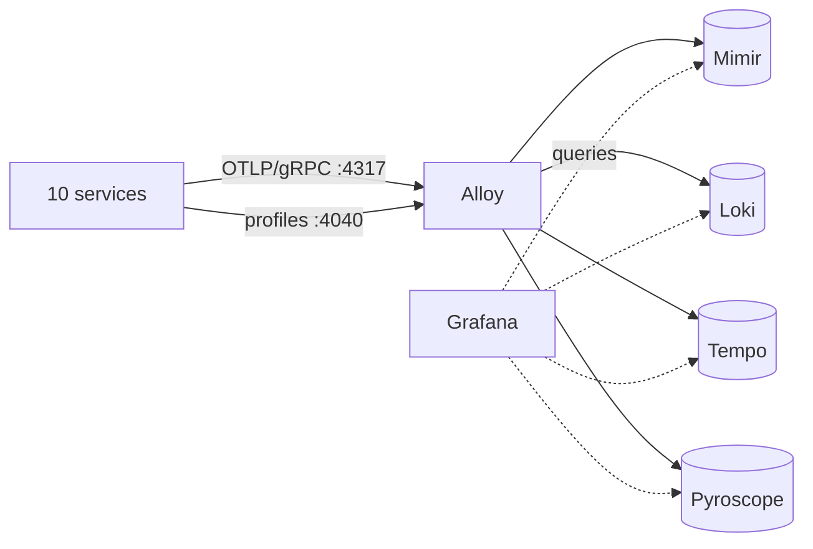

# platform-demo-observability

platform · observability

The Grafana LGTM stack as a docker compose project, the Alloy pipeline, the provisioned datasources and the ten service dashboards. The Kubernetes version of the same stack is the set of charts in <code>platform-demo-helm/monitoring</code>; it is not deployed on the EKS cluster at the moment, so this compose project is the way to run it.

Metrics<strong>Mimir</strong><small>remote_write :9009</small>

Logs<strong>Loki</strong><small>native OTLP :3100</small>

Traces<strong>Tempo</strong><small>OTLP :4317, query :3200</small>

Profiles<strong>Pyroscope</strong><small>via Alloy :4040</small>

## Telemetry path

Services push everything; nothing is scraped. `service.name` becomes the Prometheus `job` and Loki `service_name`, which is
what every dashboard filters on. The contract is described in the
[master reference](https://github.com/platform-boutique/platform-demo-docs) (observability contract).

## What is in this repository

| Path | Purpose |
|---|---|
| `docker-compose.yaml` | Whole system plus the LGTM stack on one bridge network (original, pre-OTLP digests) |
| `docker-compose.otlp.yaml` | Overlay for the OTLP/gRPC contract; uses the `1.0.0` release images |
| `alloy/config.otlp.alloy` | OTLP receivers, batch processor, exporters to Mimir/Loki/Tempo, Pyroscope receiver |
| `grafana/provisioning/` | Datasources (`mimir`, `loki`, `tempo`, `pyroscope`) and the ten dashboards |
| `mimir/`, `loki/`, `tempo/`, `pyroscope/` | Single-binary configurations for local use |
